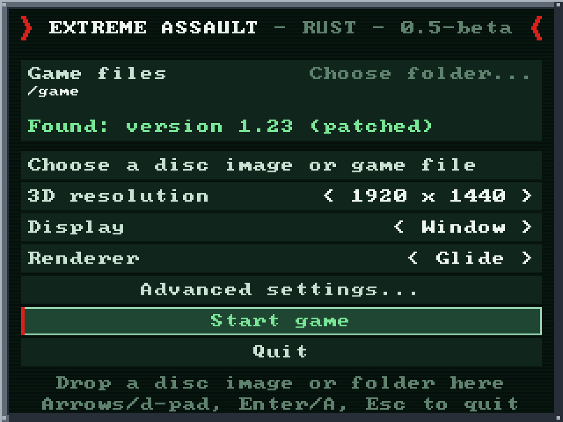

# Extreme Assault, recompiled

A native Windows and Linux version of Extreme Assault, made by translating the game's original Windows program statically into Rust, on a new runtime built on SDL3. The version is in `VERSION`, and releases are at https://github.com/retro-gaming-tools/xa-rust/releases.

The coding was done by AI (Claude, by Anthropic). The testing was done by a human.

**No game data is included.** You need Extreme Assault by Blue Byte: the English CD (version E 1.1.0), the German CD (R 1.0.1), or a copy patched to version 1.23. The program reads the game's files from your copy when it starts, and checks every program file by SHA-256 before it runs.

## The launcher

The launcher opens before the game. Your choices are saved in `settings.ini` beside the program (beside the `.AppImage` file on Linux), and `--play` on the command line skips the launcher.

- **Game files**: where your copy of the game is. Click *Choose folder...* or press Enter to pick a folder, or drop a folder or disc image onto the window. The line below it says which version was found, or what's missing.
- **Choose a disc image or game file**: pick a disc image or any file of the game.
- **3D resolution**: the size the Glide renderer draws the 3D view at, from the original 640 x 480 upwards. With the Software renderer it's greyed out.
- **Display**: *Window* or *Fullscreen*.
- **Renderer**: *Glide* (`XA_3DFX.EXE`, drawn by the port) or *Software* (`XA.EXE`, the game's own renderer). Renderers the chosen copy doesn't have are skipped, such as Glide on the German disc.
- **Advanced settings...** opens a second page, described below.
- **Start game** and **Quit**.

### Advanced settings

The defaults suit most machines. *Back* or Escape returns to the first page.

- **3D drawn by**: *GPU (OpenGL)* (the default) or *CPU*, for Glide.
- **Only 256-colour modes**, **Only low resolutions** and **Fixed texture memory**: the original's start-up options, described under *Supported versions*. Off by default.

The launcher works with the mouse, the keyboard (arrow keys to choose and change, Enter to confirm, Escape to quit) and a controller (d-pad to choose and change, A to confirm, Start to start the game, B to quit).

## Supported versions

The game came as two programs: `XA_3DFX.EXE` for 3Dfx (Glide) cards and `XA.EXE`, the software renderer. The port carries both, checks the one it starts by SHA-256, and lets you choose in the launcher (*Renderer*: Glide or Software). It supports:

| Version | Glide (`XA_3DFX.EXE`) | Software (`XA.EXE`) | Where it comes from |
|---|---|---|---|
| English CD, E 1.1.0 | `7abb3557…` | `746bb06b…` | The English disc, as a disc image (`.cue`/`.bin`) or its files |
| Patched 1.23 / 1.22 | `c24019df…` (1.23) | `952c865f…` (1.22) | An installed game with Blue Byte's updates applied |
| German CD, R 1.0.1 | none on the disc | `e69a0492…` | The German disc, as a disc image or its files |

State: the Glide programs run menus, missions, sound and CD music. The software programs reach the menus and missions (English 1.1 played mission 1, German 1.0.1 reaches the main menu); they're newer and less tried. The German disc has no Glide program, so the launcher uses software for it. The German 3Dfx patch (1.10, `xa_r110`) isn't supported yet.

- **Glide** is drawn by the port at the resolution you choose (*3D resolution*), on the graphics card or the processor.
- **Software** is the game's own renderer, at the game's own resolutions. Choose them in the game: *Options*, *Resolution Setup* lists all of its low- and high-resolution methods, in 256 colours or HiColor, as on a real VESA card.
- The original's start-up options are rows on the launcher's advanced page, since a modern machine doesn't need them: *Only 256-colour modes* (`forbid16bitcolor`, what `LOWCOL.BAT` did), *Only low resolutions* (`forbidhires`, what `LOWMEM.BAT` did) and *Fixed texture memory* (`forbidautoalloc`). They're off by default, as with `START.BAT`. Two options aren't offered: `nonetwork`, because the port has no IPX network to switch off, and `ff` for force-feedback joysticks, which the port doesn't drive.

### Files Glide needs

For Glide, the game folder needs `XA_3DFX.EXE` with one of the hashes in the table above. Nothing else from a 3Dfx patch is needed:

- **English CD 1.1.0:** everything is on the disc. Use the disc image or the disc's files as they are; no patch.
- **Patched 1.23:** use the folder Blue Byte's update left behind, with its `XA_3DFX.EXE` (`c24019df…`) and the `DATA` folder of the install. The update's `XA.EXE` (1.22) is the software program.
- **`GLIDE2X.OVL` isn't needed.** That was the driver for a real Voodoo card; the port draws Glide itself and never loads it. It can be missing, or be another Glide wrapper's file.
- **The 3Dfx cockpit pictures** (`DATA\GLOBAL\COCKPIT\3DFX\*.RLE`) come with the English disc and the install; keep them in place.
- **German CD 1.0.1:** the German 3Dfx patch (1.10, `xa_r110.zip`) isn't supported yet, so the German version runs in software only.

Other patch levels and other languages' discs aren't supported: their programs differ, and the launcher says which version it found.

With a disc image, the port unpacks the disc once and plays its CD music straight from the image. It also starts with CD music and the controller switched on; a patched install keeps its own settings.

## Why the source is here

So you don't have to trust a download. Everything that makes the release is in this repository:

- `src/`: the game's code, translated to Rust by the recompiler. Don't edit it by hand: it's regenerated.
- `mods/`: hand-written Rust that replaces some of the game's functions (see below).
- `runtime/`: the hand-written runtime: the CPU state, the Windows functions the game calls, video, sound and input on SDL3, and the launcher.
- `recompiler/`: the static recompiler that wrote `src/`.
- `build/`, `build.sh`, `regenerate.sh`: the Docker build for the release, and the check that the code matches your game.
- `.github/workflows/build.yml`: GitHub builds the release from a tagged commit, with build provenance.
- `CHANGELOG.md`: what changed in each version, and `changes.sh`, which shows the full diff between two versions.

## Building

You need Docker, and nothing else.

    ./build.sh

This builds an image with pinned tools (Rust, MinGW, SDL3, appimagetool), then the Windows zip and the Linux AppImage, into `dist/`.

## Checking the code against your game

    ./regenerate.sh /path/to/your/game

This builds the recompiler, runs it on your copy of the game with the settings in `recomp.json`, and compares the result with `src/` and the rest of this repository. No difference means the published code is exactly what the recompiler makes from the game.

## Checking a release

Release files built by GitHub carry a provenance attestation. With the GitHub CLI:

    gh attestation verify <file> --repo retro-gaming-tools/xa-rust

It tells you which workflow run and which commit built the file.

## Comparing versions

Each version has a tag `v<version>`, such as `v0.5-beta`.

    ./changes.sh 0.5-beta 0.6-beta > changes.diff

This lists the changelog entries, the commits and the files that changed, then the diff of everything written by hand: the runtime, the mods, the recompiler and the build. The translated code in `src/code/` is only summarised, because a regeneration rewrites much of it. Add `--code` for its full diff.

## Mods

Each `.rs` file in `mods/` is hand-written Rust, and a `pub fn f_XXXXXXXX(cpu: &mut Cpu)` in one replaces the game's function at that address everywhere. The translated original stays callable as `o_XXXXXXXX`. Start a mod file with `use crate::code::*;` and `use recomp_runtime::Cpu;`. A line `//! launcher: LABEL` gives the mod an On/Off row in the launcher (`launcher-off:` for one that starts off, `launcher-advanced:` for one on the advanced page), and its functions then begin with `if !host::mod_enabled(cpu, "FILE") { return o_XXXXXXXX(cpu); }`.

## Licence

The recompiler, the runtime, the mods and the build scripts are under the MIT licence in `LICENSE`.

MIDI music is played by [rustysynth](https://github.com/sinshu/rustysynth) (MIT) with the GeneralUser GS sound bank v2.0.3 by S. Christian Collins (https://www.schristiancollins.com), which is built into the program. Its licence is in `runtime/assets/GeneralUser-GS-LICENSE.txt`.

The code in `src/code/` is translated from the program files of the original game, including the Microsoft C runtime it comes with. That code belongs to its rights holders, so no licence is granted for it here. This project isn't affiliated with or endorsed by them. Please buy the game.

Generated for `extreme-assault` by the recompiler in `recompiler/`.
